  " width="100%" />

 

**Привет! Я Артём, и я уже 3 года в сфере IT. Я бэкенд-разработчик на PHP — пишу серверную логику, API и утилиты, разбираю внутренности сайтов и работаю с кибербезопасностью: red team, аудит и пентест веб-приложений.**

 

  
   
  

 

**_Мой стек_**

  
  

 

  
   
  <b><i>It's me LOL :D</i></b>

